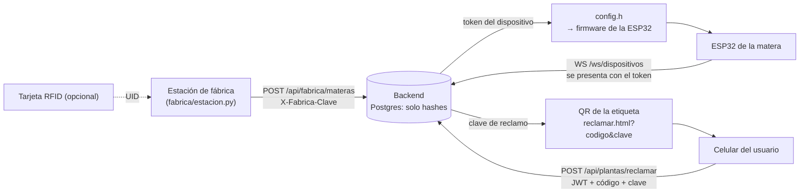
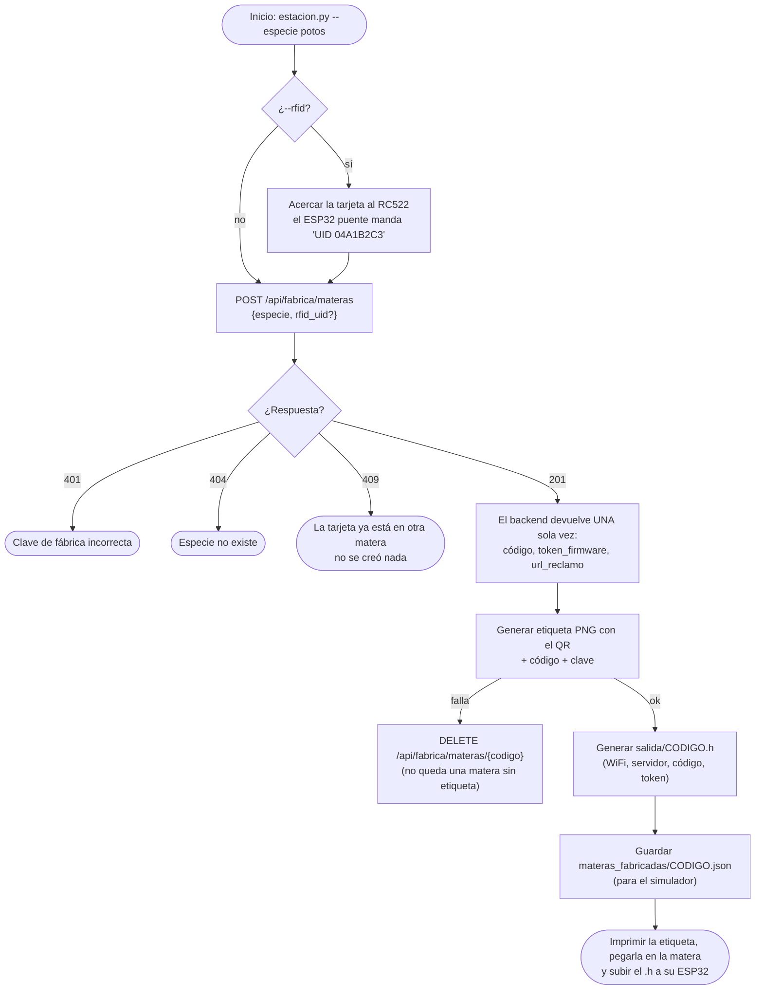
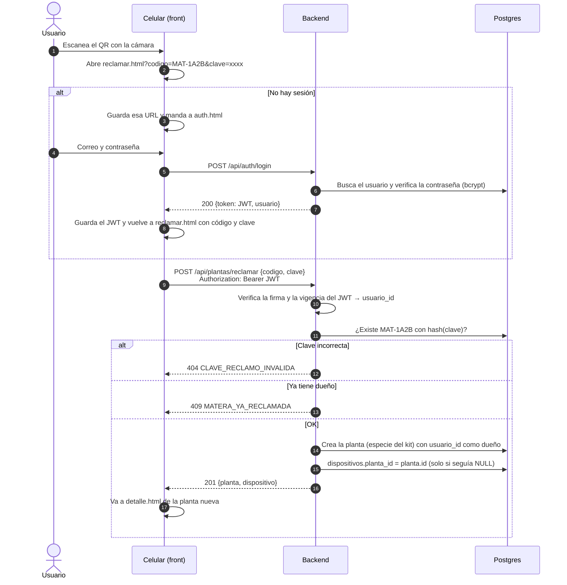
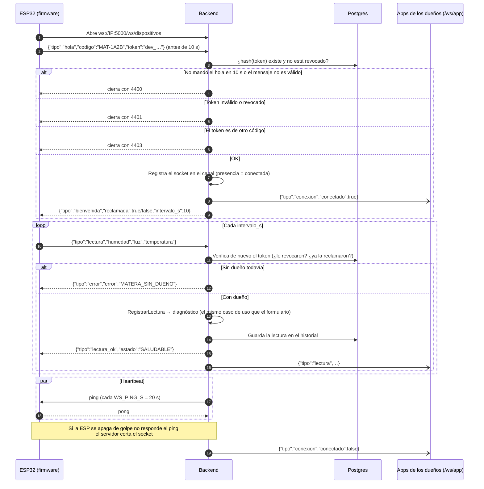
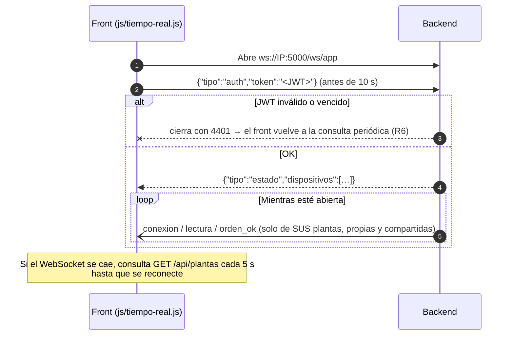

# Cómo funciona: fábrica, reclamo con QR y handshake de la ESP

Guía para el equipo: qué pasa desde que se "fabrica" una matera hasta que sus lecturas aparecen en vivo en el celular del dueño. Los diagramas son Mermaid y GitHub los dibuja solo.

## 1. La idea en una imagen: tres secretos, tres dueños

Cada matera tiene un **código** (`MAT-1A2B`) y la fábrica le genera dos secretos. En la base de datos solo quedan sus **hashes**: si se filtra la BD, no sirven para nada.



| Secreto | Dónde vive | Para qué sirve | Quién lo ve |
|---|---|---|---|
| **Token del dispositivo** | Firmware de la ESP (`config.h`) | Que la ESP demuestre quién es al conectarse | Solo la ESP |
| **Clave de reclamo** | QR impreso en la etiqueta | Que el primer usuario que la escanee se vuelva dueño | Quien tenga la matera en la mano |
| **JWT del usuario** | Navegador del usuario (después del login) | Que el backend sepa qué usuario hace cada petición | Solo ese usuario |
| UID de la tarjeta RFID *(opcional)* | Tarjeta pegada a la matera | Identificar la matera **dentro de la fábrica** | Cualquiera con un lector |

**Lo que vincula la ESP con la planta del usuario es el código de la matera.** El token y la clave pertenecen a ese mismo código. La tarjeta RFID no participa en el vínculo.

## 2. En la fábrica



En la BD, la matera queda en `dispositivos` con `planta_id = NULL`, es decir, **sin dueño**. Así puede conectarse, pero sus lecturas se rechazan con `MATERA_SIN_DUENO` hasta que alguien la reclame.

## 3. El usuario: login y reclamo con el QR



Si dos personas escanean el mismo QR a la vez, solo una gana. El `UPDATE` lleva `WHERE planta_id IS NULL`; el que llega segundo recibe 409 y su planta recién creada se borra.

## 4. Handshake de la ESP32 (`/ws/dispositivos`)

La ESP abre un WebSocket y lo deja abierto. **Mientras el socket esté abierto, la matera está conectada.**



Cosas que conviene saber para las pruebas:
- El token se verifica **en cada lectura**, no solo en el saludo. Por eso una matera reclamada mientras estaba conectada empieza a reportar sin reconectarse, y una revocada se corta al instante.
- El firmware **no usa `delay()`** en el `loop()`. Si lo usara, no respondería los ping y el servidor la daría por muerta.
- Si la ESP se reconecta antes de que el servidor note la caída, la conexión nueva reemplaza a la vieja y no cuenta como desconexión.

## 5. Handshake del front (`/ws/app`)

El navegador no deja poner la cabecera `Authorization` en un WebSocket, y poner el JWT en la URL lo dejaría en los logs. Por eso el JWT va en el primer mensaje.



## 6. Cómo probarlo de punta a punta

```bash
# 1. Backend (con Postgres arriba y backend/.env listo)
cd backend && .venv/bin/alembic upgrade head && .venv/bin/flask --app presentation.app run --host 0.0.0.0

# 2. Front (otra terminal)
cd frontend && python -m http.server 5500

# 3. Fábrica (otra terminal): crea la matera y muestra su QR
cd fabrica && .venv/bin/python estacion.py --especie potos --una            # sin lector
cd fabrica && .venv/bin/python estacion.py --especie potos --una --rfid     # con el RC522

# 4. La "ESP": el simulador con la matera recién fabricada
python simulador_esp32.py --matera materas_fabricadas/MAT-XXXX.json --ws
#    Va a decir "sin dueño: falta escanear el QR" y sus lecturas se rechazan.

# 5. Escanear el QR de la terminal (o de salida/MAT-XXXX_etiqueta.png) con el celular,
#    iniciar sesión → la planta aparece y las lecturas empiezan a llegar en vivo.
```

Para que el celular abra el QR, `FRONT_URL` en `backend/.env` y `ESP_SERVIDOR` en `fabrica/.env` tienen que usar la **IP del PC en la red** (no `localhost`), y `CORS_ORIGIN` tiene que permitir esa IP.

### Con la ESP32 real (en el PC que tenga el Arduino IDE)

> El firmware **todavía no se ha compilado ni subido a una placa**: si sale un error de compilación, anótenlo tal cual. Los sensores aún son **simulados** (`leerSensores()` en el `.ino`): para probar la conexión y la página alcanza; para datos reales solo hay que cambiar esa función.

1. Arduino IDE → *Boards Manager*: **esp32** (Espressif). *Library Manager*: **WebSockets** (Markus Sattler) y **ArduinoJson** (Benoit Blanchon).
2. El PC del backend y la ESP32 en **la misma red WiFi de 2,4 GHz** (la ESP32 no ve redes de 5 GHz). Las redes de la universidad suelen bloquear el tráfico entre equipos: si no conecta, usen el **hotspot de un celular**.
3. Sacar la IP del PC (`ip a` en Linux, `ipconfig` en Windows) y ponerla en:
   - `backend/.env`: `FRONT_URL=http://<IP>:5500` y `CORS_ORIGIN=http://<IP>:5500,http://localhost:5500`
   - `fabrica/.env`: `ESP_SERVIDOR=<IP>:5000`, `ESP_WIFI_SSID` y `ESP_WIFI_CLAVE`
4. Backend con `--host 0.0.0.0` (si no, solo acepta conexiones del mismo PC) y front con `python -m http.server 5500`. Si el PC tiene firewall, abrir los puertos 5000 y 5500.
5. `fabrica/.venv/bin/python fabrica/estacion.py --especie potos --una` → copiar `fabrica/salida/MAT-XXXX.h` como `firmware/matera_esp32/config.h`.
6. Abrir `firmware/matera_esp32/matera_esp32.ino`, placa **ESP32 Dev Module**, elegir el puerto y subir. Si se queda en *Connecting…*, mantener presionado el botón **BOOT** de la placa mientras empieza a subir.
7. Monitor Serie a **115200**: debe conectarse al WiFi, luego al servidor, y decir *sin dueño: falta escanear el QR*.
8. Escanear el QR (en la terminal de la estación o en `salida/MAT-XXXX_etiqueta.png`) con el celular e iniciar sesión → la planta aparece y las lecturas llegan en vivo. En *Dispositivos*, **Parpadear** hace titilar el LED azul de la placa.

### Errores comunes

| Síntoma | Causa |
|---|---|
| El celular no abre el QR | `FRONT_URL` apunta a `localhost`; la estación lo advierte con `!` |
| `409 TARJETA_RFID_EN_USO` | Esa tarjeta ya está pegada a otra matera (`--identificar` dice cuál) |
| La ESP se conecta pero dice `MATERA_SIN_DUENO` | Normal: falta que alguien escanee el QR |
| La ESP se cierra con 4401 | El `config.h` no es el de esa matera, o la matera se descartó |
| `ERROR RC522 sin respuesta` | Cableado del lector; revisa que esté a 3.3 V (ver `fabrica/README.md`) |
| La ESP no pasa de "conectando al WiFi" | Red de 5 GHz, clave mal escrita en `fabrica/.env` (se regenera el `.h`) o red con portal cautivo |
| WiFi OK pero no llega al servidor | IP equivocada en `ESP_SERVIDOR`, backend sin `--host 0.0.0.0`, firewall o red que aísla equipos |
| `Permission denied: /dev/ttyUSB0` | Agrega tu usuario al grupo `uucp` (Arch) o `dialout` (Ubuntu) |
